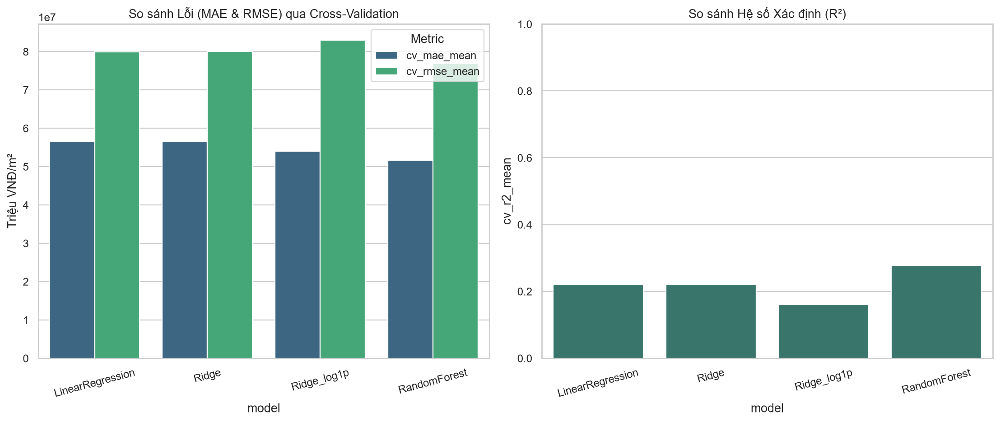
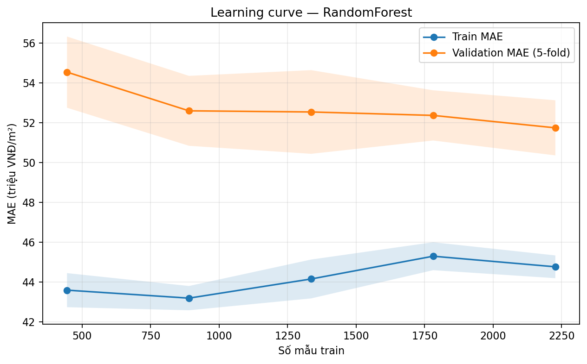
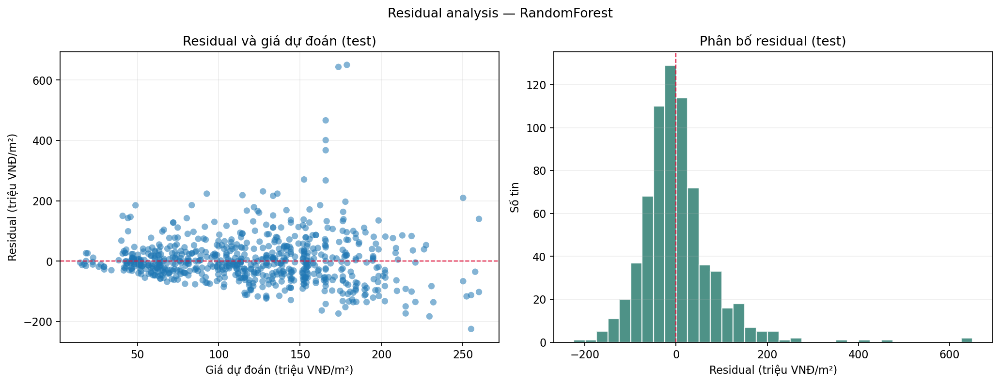
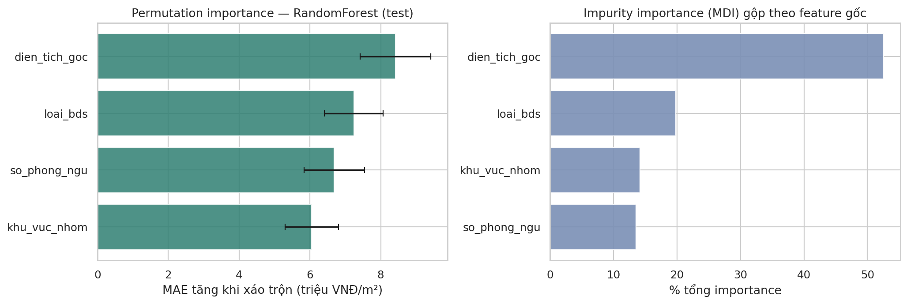
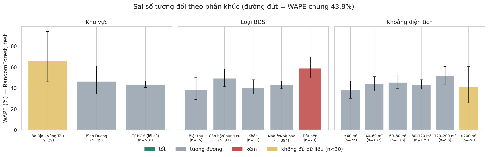

# PHẦN NỘI DUNG BÁO CÁO KHOA HỌC — BÀI TẬP 4: MÔ HÌNH HÓA VÀ SO SÁNH KẾT QUẢ

**Đề tài:** Dự đoán đơn giá rao bán bất động sản theo m² từ dữ liệu Nhà Đất CafeLand  
**Nhóm:** 22 & 24  
**Phụ trách biên soạn phần mô hình và diễn giải:** Lê Nhật Việt  
**Vị trí tích hợp:** Phần *Mô hình hóa – Kết quả – Thảo luận và hạn chế – Kết luận* của báo cáo khoa học Final Project. Phần EDA do nhóm đã thực hiện được dẫn chiếu, không sao chép toàn bộ vào đây.

> **Phạm vi kết luận:** Các kết quả dự báo **giá rao bán theo m²** trong bộ tin đăng mà nhóm thu thập và xử lý, không phải giá giao dịch xác thực. MAE, RMSE, hệ số và các giá trị đơn giá trong báo cáo được biểu diễn bằng **triệu VNĐ/m²** khi không ghi đơn vị khác. Nhãn vùng là nhãn nội bộ trong dữ liệu phục vụ phân tích.

## 1. Đặt vấn đề

Giá bất động sản phụ thuộc vào nhiều thông tin xuất hiện trong tin đăng, trong đó có khu vực, loại tài sản, diện tích và cấu trúc phòng. Việc dùng một giá trung bình duy nhất để so sánh giữa các loại hình và địa bàn có thể gây sai lệch. Trên bộ dữ liệu tin rao Nhà Đất CafeLand, nghiên cứu đặt ra ba câu hỏi: (1) có thể dự đoán đơn giá chào bán theo m² từ các đặc trưng quan sát được với sai số bao nhiêu; (2) mô hình tuyến tính hay phi tuyến phù hợp hơn trong các phương án thử nghiệm; và (3) kết quả và sai số mô hình gợi ý những ứng dụng nghiệp vụ và hạn chế gì?

Mục tiêu trực tiếp là xây dựng, tinh chỉnh và so sánh các mô hình hồi quy; mục tiêu mở rộng là diễn giải các biến liên quan đến dự báo, xác định nhóm tin có sai số đáng lưu ý và đánh giá khả năng ứng dụng dưới dạng demo tham khảo. Nghiên cứu không nhằm xác nhận giá bán thực hoặc thay thế thẩm định của chuyên gia.

## 2. Dữ liệu và phương pháp

### 2.1. Chuẩn bị dữ liệu và biến mục tiêu

Nguồn modeling xuất phát từ dữ liệu bất động sản đã được thu thập, chuẩn hóa và thực hiện EDA ở Bài tập 2–3. Theo [preprocessing_scope_audit.csv](preprocessing_scope_audit.csv), từ **5.435 dòng** trước bước khử trùng và lọc phạm vi, nhóm còn **3.480 tin đủ điều kiện modeling**. Các bước lựa chọn mẫu bao gồm khử trùng theo `link_nguon`, loại tin cho thuê được nhận diện rõ, giới hạn diện tích trong **10–2.000 m²**, giữ các dòng có **giá và diện tích gốc quan sát được** và đơn giá mục tiêu hợp lệ. Dữ liệu được tách thành **2.784 train** và **696 test** theo tỷ lệ **80/20** với `random_state=42`.

Biến cần dự báo là **đơn giá rao bán theo m²**, được tính từ hai giá trị gốc quan sát được:

**Công thức:** `price_per_m2 = gia_goc / dien_tich_goc`

Trong đó, `gia_goc` là giá rao bán (VNĐ), còn `dien_tich_goc` là diện tích (m²).

Tệp kết quả lưu đơn giá theo **VNĐ/m²**; các bảng trong báo cáo đổi sang **triệu VNĐ/m²** cho dễ đọc. Bốn đặc trưng đầu vào của pipeline chính là `dien_tich_goc`, `so_phong_ngu`, `khu_vuc_nhom` và `loai_bds`.

Để tránh **target leakage**, nhóm không đưa `gia`, `gia_goc` hoặc `price_per_m2` vào các biến X. Những phép điền khuyết, tạo cờ thiếu, chuẩn hóa biến số và one-hot encoding được đặt trong `scikit-learn Pipeline`/`ColumnTransformer`, chỉ học tham số trên train hoặc trên từng fold CV. Đánh giá correlation/VIF trên train cho thấy **VIF lớn nhất khoảng 1,22**, chưa có chỉ báo đa cộng tuyến tuyến tính nghiêm trọng trong bộ đặc trưng hiện tại. Chi tiết tham khảo: `docs/model_preprocessing_notes.md`, [feature_contract.csv](feature_contract.csv), [vif_train.csv](vif_train.csv).

### 2.2. Thiết kế mô hình và quy tắc đánh giá

Nhóm huấn luyện và so sánh bốn cấu hình:

1. **LinearRegression:** baseline tuyến tính để đối chiếu.
2. **Ridge:** hồi quy tuyến tính có regularization, dùng để kiểm tra tính ổn định và diễn giải hệ số.
3. **Ridge với `log1p` target:** kiểm tra cách biến đổi biến mục tiêu; các metric được quy về thang đơn giá gốc.
4. **RandomForestRegressor:** mô hình phi tuyến nhằm khai thác quan hệ phi tuyến và tương tác giữa các đặc trưng.

Việc tinh chỉnh siêu tham số và so sánh sử dụng **5-fold cross-validation trên tập train**. Kết quả được đánh giá bằng **MAE, RMSE và R²**; MAE/RMSE càng thấp, R² càng cao thì càng tốt trong cùng bộ test. Mô hình cuối được chọn theo kết quả CV rồi đánh giá trên tập test giữ riêng. Learning curve và phân bố residual được dùng để rà soát chênh lệch train–validation và sai số lớn.

Nghiên cứu **không sử dụng nested CV hoàn chỉnh**; các metric cross-validation trong bảng là cơ sở so sánh giữa các cấu hình hiện có, không phải bảo đảm hiệu năng ngoài thị trường. Nguồn thiết kế và tham số: `notebooks/08_model_training_comparison.ipynb`, [model_hyperparameters.csv](model_hyperparameters.csv).

## 3. Kết quả và so sánh mô hình

### 3.1. Hiệu quả trên cross-validation và tập kiểm tra

| Cấu hình | MAE CV | MAE test | RMSE test | R² test |
|---|---:|---:|---:|---:|
| LinearRegression | 56,64 | 56,06 | 81,34 | 0,241 |
| Ridge | 56,62 | 56,11 | 81,42 | 0,240 |
| Ridge + `log1p` target | 54,04 | 55,41 | 85,02 | 0,171 |
| **RandomForest (được chọn)** | **51,67** | **53,82** | **81,02** | **0,247** |

*Nguồn: [model_comparison.csv](model_comparison.csv). MAE và RMSE được chuyển từ VNĐ/m² sang triệu VNĐ/m², làm tròn hai chữ số thập phân.*

RandomForest có **MAE CV nhỏ nhất**, thấp hơn LinearRegression khoảng **8,77%**. Trên test, MAE RandomForest đạt **53,82 triệu VNĐ/m²** (thấp hơn LinearRegression khoảng **4,00%**), RMSE **81,02 triệu VNĐ/m²** và R² **0,247**. Chênh lệch giữa hiệu quả CV và test cho thấy cần thận trọng khi suy rộng từ kết quả thử nghiệm. R² bằng 0,247 cho thấy mô hình mới giải thích được một phần biến thiên giá rao trong mẫu kiểm tra; không đủ cơ sở để khẳng định dự báo chính xác từng tin.

RandomForest có MAE train **44,41** so với MAE CV **51,67**; mức chênh **14,07% khi lấy CV MAE làm mẫu số** là dấu hiệu cần theo dõi khả năng tổng quát hóa. Nhóm sử dụng learning curve và residual diagnostics để xem thêm tính ổn định, chứ không chỉ công bố điểm số tổng hợp. **Ridge** tiếp tục có vai trò đối chứng và diễn giải hệ số; **RandomForest** là mô hình chính trong `models/best_model.joblib`.

**Hình 1 — So sánh chỉ số các mô hình.**  

**Hình 2 — Learning curve mô hình được chọn.**  

**Hình 3 — Phân tích sai số residual.**  

### 3.2. Diễn giải các biến liên quan tới đơn giá

Trên **3.480 tin modeling**, trung vị đơn giá của nhóm TP.HCM lõi cũ là **110,94**, Bình Dương **47,62** và Bà Rịa – Vũng Tàu **40,00 triệu VNĐ/m²** (tương ứng **3.069**, **269**, **142** tin). Các mức này thể hiện mẫu dữ liệu được chọn, **không phải mốc giá đại diện cho toàn bộ thị trường**.

Trong Ridge, khi giữ những biến được đưa vào mô hình không đổi, hai nhãn Bình Dương và Bà Rịa – Vũng Tàu có hệ số lần lượt khoảng **−60,32** và **−54,86 triệu VNĐ/m²** so với TP.HCM lõi cũ. Hệ số loại BĐS **đất nền** khoảng **−60,47** và **căn hộ/chung cư** khoảng **−53,20 triệu VNĐ/m²** so với loại tham chiếu nhà ở/nhà phố. Diện tích thêm **10 m²** gắn với chênh lệch ước lượng khoảng **−3,16 triệu VNĐ/m²** trong mô hình Ridge, khi giữ các đặc trưng khác cố định. Các hệ số phản ánh **liên hệ thống kê**, không chứng minh tác động nhân quả hay dùng trực tiếp để điều chỉnh giá của một bất động sản cụ thể.

Permutation importance của RandomForest (tăng MAE test sau khi xáo trộn biến, triệu VNĐ/m²) cho thấy `dien_tich_goc` **8,42**, `loai_bds` **7,24**, `so_phong_ngu` **6,69** và `khu_vuc_nhom` **6,05**. Vì các biến có thể tương tác hoặc chứa thông tin trùng nhau, không được cộng các giá trị importance thành “tổng tác động” lên giá.

**Hình 4 — Tầm quan trọng của đặc trưng với RandomForest.**  

Nguồn: [linear_coefficients.csv](linear_coefficients.csv), [importance_table.csv](importance_table.csv), [model_findings.md](model_findings.md).

### 3.3. Phân tích độ ổn định theo phân khúc

Trên **696 tin test**, WAPE toàn mẫu khoảng **43,8%**. WAPE của **đất nền** là **58,74%** với **73** tin, cao hơn **nhà ở/nhà phố 42,95%** với **394** tin và **căn hộ/chung cư 49,29%** với **97** tin. MAE của đất nền là **40,86**, trong khi MAE của nhà phố **64,07 triệu VNĐ/m²**. Do mức giá nền khác nhau, so sánh chỉ bằng MAE dễ gây hiểu nhầm; cần xem cùng lúc **WAPE, MAE, quy mô mẫu và khoảng bất định**.

Nhóm Bà Rịa – Vũng Tàu trong test chỉ có **29** tin và nhóm diện tích trên **200 m²** chỉ có **28** tin; các kết luận theo từng phân khúc nhỏ chưa đủ chắc chắn để áp dụng rộng. Phân tích của Phúc cho biết riêng đất nền có khoảng **96%** tin train thiếu thông tin phòng ngủ, một minh họa rằng mức độ đầy đủ và ý nghĩa của đặc trưng có thể khác nhau giữa các loại BĐS.

**Hình 5 — Sai số của mô hình theo nhóm bất động sản.**  

Nguồn: [error_by_segment.csv](error_by_segment.csv), [model_findings.md](model_findings.md).

### 3.4. Thử nghiệm bổ sung đặc trưng phường/xã — chưa triển khai chính thức

Thử nghiệm của Nguyễn Hùng Phúc bổ sung `phuong_xa` bằng TargetEncoder đặt trong pipeline. Với RandomForest, MAE CV thay đổi từ **51,67** xuống **37,41 triệu VNĐ/m²** (**giảm 27,6%**); với GroupKFold, MAE giảm từ **52,45** xuống **38,10 triệu VNĐ/m²** (**giảm 27,4%**). Đây là bằng chứng cho thấy **độ chi tiết địa lý có tiềm năng cải thiện dự báo**.

Tuy nhiên, các kết quả trong [feature_candidates_cv.csv](feature_candidates_cv.csv) và [feature_candidates_test_confirmation.csv](feature_candidates_test_confirmation.csv) thuộc **thử nghiệm lựa chọn đặc trưng bổ sung**, không phải hiệu năng của mô hình đang lưu trong `models/best_model.joblib`. Vì tập test đã được sử dụng để xác nhận ứng viên, những cải tiến này nên được đánh giá tiếp trên dữ liệu hoàn toàn mới trước khi đưa vào ứng dụng. `vi_tri` và `tieu_de` vẫn là nhóm đặc trưng `FORBIDDEN_CURRENT` trong [feature_contract.csv](feature_contract.csv) của pipeline chính.

## 4. Thảo luận giá trị ứng dụng

**Thứ nhất, so sánh giá theo nhóm tương đồng.** Kết quả mô tả và hệ số hồi quy đều cho thấy đơn giá trong mẫu thay đổi theo nhãn khu vực và loại hình. Người dùng tin rao nên đối chiếu với tài sản cùng phân khúc thay vì so với trung bình toàn bộ địa bàn. Cách ứng dụng này hỗ trợ **lọc và kiểm tra tin cần tìm hiểu thêm**, không tạo ra bằng chứng một tin cụ thể đang bị định giá thấp.

**Thứ hai, ưu tiên cải thiện dữ liệu địa chỉ chi tiết.** Việc bổ sung phường/xã cho kết quả CV tích cực, cho thấy nâng chất lượng dữ liệu đầu vào có thể mang lại giá trị hơn chỉ tăng độ phức tạp của thuật toán. Để triển khai thực tế cần kiểm tra tính nhất quán của phường/xã và đánh giá lại với cách chia dữ liệu phù hợp.

**Thứ ba, minh bạch sai số khi trình diễn.** `app.py` cung cấp luồng nhập đặc trưng và xuất đơn giá ước lượng để mô phỏng tính năng “định giá nhanh”. Vì chưa có khoảng dự báo được hiệu chuẩn, kết quả từ app nên ghi rõ **“ước lượng đơn giá rao tham khảo”**, đồng thời thông báo sai số chung và hạn chế với phân khúc ít dữ liệu. Không nên suy từ chênh lệch giữa giá niêm yết và giá dự đoán ra kết luận mua bán hoặc mức giá giao dịch hợp lý.

## 5. Hạn chế và rủi ro nghiên cứu

1. **Dữ liệu giá rao, không phải giao dịch:** chưa có giá chốt thực tế hoặc thông tin xác thực về toàn bộ điều kiện pháp lý, tiện ích, thời điểm giao dịch. Vì vậy, kết luận chỉ giới hạn trong dữ liệu rao bán.
2. **Sai lệch đại diện mẫu:** TP.HCM lõi cũ chiếm khoảng **88,2%** bộ modeling (3.069/3.480 tin). Kết quả ở những nhóm ít tin không thể suy rộng chắc chắn cho toàn bộ vùng.
3. **Giá quy đổi và ngoại lai:** rà soát `modeling_base.csv` phát hiện **7** tin có `gia_goc < 10 triệu VNĐ`, **10** tin có giá/m² dưới **1 triệu**, và **25** tin trên **500 triệu VNĐ/m²**. Những trường hợp này cần đối chiếu nguồn và parser, chưa được phép mặc định toàn bộ là lỗi rồi tự xóa theo test.
4. **Trùng tin cùng tài sản:** khử trùng theo `link_nguon` chưa loại trừ bản sao dưới URL khác. Kiểm tra GroupKFold giúp đánh giá độ bền cho ứng viên mới nhưng không bảo đảm mọi dạng trùng gần giống đã được loại bỏ.
5. **Overfitting và khả năng tổng quát hóa:** train MAE thấp hơn CV MAE của RandomForest; các thay đổi đặc trưng thử nghiệm đã được đánh giá trên cùng tài nguyên dữ liệu. Dữ liệu độc lập mới là cần thiết để xác nhận hiệu quả triển khai.
6. **Mức độ giải thích:** Ridge coefficients và permutation importance gợi ý mối liên hệ/đóng góp dự báo, **không chứng minh nhân quả**; các biến chưa đo có thể ảnh hưởng cả giá và đặc trưng trong mô hình.
7. **Giới hạn demo:** ứng dụng mới là minh họa dự đoán điểm, chưa có khoảng dự báo đáng tin cậy, theo dõi sai số theo thời gian hay hệ thống phát hiện đầu vào nằm ngoài phân phối học.

## 6. Kết luận và hướng phát triển

Đề tài đã xây dựng và so sánh **bốn cấu hình** thuộc các nhóm hồi quy tuyến tính, điều chuẩn và phi tuyến, đánh giá bằng **MAE, RMSE, R²**. Trong các mô hình được thử nghiệm, **RandomForest** được chọn theo hiệu quả CV, đạt **MAE test 53,82 triệu VNĐ/m²**, **RMSE test 81,02 triệu VNĐ/m²** và **R² test 0,247**. Hệ thống đã minh họa đầy đủ chuỗi xử lý dữ liệu → huấn luyện → so sánh → giải thích → ứng dụng, song mức sai số hiện có chưa cho phép coi đây là công cụ thẩm định giá chính xác.

Ba kết luận mang giá trị nghiệp vụ là: **(1)** nên so sánh giá rao trong các nhóm khu vực và loại hình tương đồng; **(2)** đặc trưng vị trí cấp phường/xã có triển vọng cải thiện, thể hiện qua **27,6% giảm MAE CV** trong thử nghiệm nhưng chưa được triển khai chính thức; và **(3)** cần nêu bật rủi ro dự báo theo phân khúc, đặc biệt **đất nền WAPE 58,74%**. Hướng phát triển tiếp theo là kiểm tra lại dữ liệu giá, giảm tin trùng, chuẩn hóa địa chỉ chi tiết, đánh giá lại trên dữ liệu độc lập và bổ sung cơ chế mô tả độ không chắc chắn cho demo.

## 7. Căn cứ và minh bạch về hỗ trợ AI

| Tài liệu nội bộ | Nội dung sử dụng |
|---|---|
| `docs/project_charter.docx`, `notebooks/05_eda_visualizations.ipynb` | Vấn đề kinh doanh và liên hệ với EDA |
| `docs/model_preprocessing_notes.md`, [preprocessing_scope_audit.csv](preprocessing_scope_audit.csv), [feature_contract.csv](feature_contract.csv) | Quy tắc lập mẫu, chống leakage, các biến đầu vào |
| `notebooks/08_model_training_comparison.ipynb`, [model_comparison.csv](model_comparison.csv), [model_hyperparameters.csv](model_hyperparameters.csv) | Cấu hình, tuning, CV và đánh giá test |
| `notebooks/09_model_interpretability.ipynb`, [model_findings.md](model_findings.md), [linear_coefficients.csv](linear_coefficients.csv), [importance_table.csv](importance_table.csv) | Hệ số, importance và giải thích |
| [error_by_segment.csv](error_by_segment.csv), [feature_candidates_cv.csv](feature_candidates_cv.csv) | Rủi ro theo phân khúc và đặc trưng mở rộng |

**Khai báo AI đối với phần tài liệu này:** Công cụ AI được dùng để hỗ trợ xây dựng bố cục, tổng hợp và diễn đạt kết quả đã lưu trong repository. AI không trực tiếp huấn luyện các mô hình được báo cáo. Thành viên phụ trách cần đọc, kiểm chứng và giải thích được những kết luận khi vấn đáp; phần khai báo AI chính thức của toàn nhóm do bộ phận tích hợp tổng hợp theo yêu cầu học phần.
